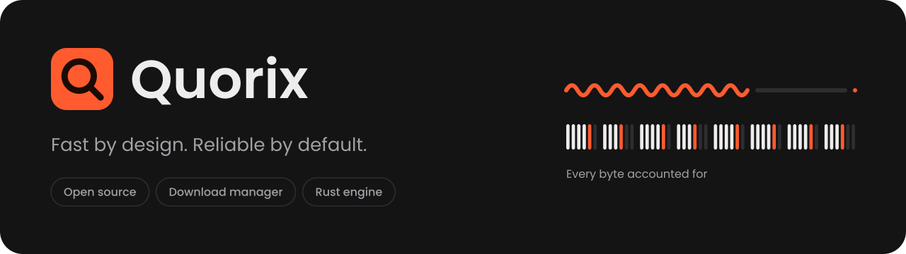

<p align="center">
  
</p>

<p align="center">
  <a href="https://github.com/konkomaji/quorix/actions/workflows/ci.yml"></a>
  <a href="LICENSE"></a>
  
  
</p>

# Quorix

Quorix is an open-source download manager.
The transfer engine is built first. The desktop application comes after it.

**Status:** early development. The command-line tool works. There is no installer.

This file tells you what Quorix can do today.
For planned work, read [ROADMAP.md](ROADMAP.md).

## Contents

- [What works today](#what-works-today)
- [Known limits](#known-limits)
- [Build](#build)
- [Use](#use)
- [How a download works](#how-a-download-works)
- [Components](#components)
- [Error codes](#error-codes)
- [Test](#test)
- [Contribute](#contribute)
- [Security](#security)
- [Licence](#licence)

## What works today

### Command-line tool `quorix`

**Transfer**

- Quorix downloads files through HTTP and HTTPS.
- Quorix uses 1 to 16 connections when the server supports byte ranges. The default is 4.
- Quorix uses one request when the server does not support byte ranges.
- Quorix writes each part directly to its final position in the file.
- Memory use for each connection has a fixed limit. It does not increase with the file size.
- If a server refuses more connections, Quorix continues with fewer connections.

**Pause, resume and recovery**

- Press Ctrl+C one time to pause. Run the same command again to continue.
- Quorix saves the progress every 2 seconds. It saves progress only after the data is on the disk.
- After a crash or a power loss, the next run continues from the last saved progress.
- Quorix continues a download only if the server proves that the file did not change. The proof is a strong `ETag`.
- If there is no proof, Quorix starts the download again from zero.
- Quorix does not mix data from two versions of a file.
- Quorix ignores a damaged progress file.

**Correctness**

- Quorix accepts a part only if the `Content-Range` from the server is the same as the request.
- Quorix stops if the file changes on the server during the download.
- Quorix examines the final size of the file.
- If you supply a SHA-256 or BLAKE3 checksum, Quorix reads the completed file from the disk and compares the checksum.
- Quorix moves the file to its destination only after all checks pass.
- A failed download puts nothing at the destination.

**Failures**

- Quorix tries again after a temporary failure. The limit is 5 retries.
- The wait time between retries increases each time. Quorix obeys the `Retry-After` value from the server.
- Quorix does not try again after a permanent failure. Examples are a file that was not found, a bad certificate, and a full disk.
- Each failure has a code and one sentence. Example: `error[QRX-E404]: the file was not found on the server (HTTP 404)`.

**Security**

- Quorix validates TLS certificates.
- Quorix follows a maximum of 10 redirects.
- Quorix refuses a redirect from `https` to `http`.
- Quorix refuses a redirect from a public address to this computer or to the local network.
- Quorix removes directory parts from a file name that the server sends. The file cannot go out of the folder that you select.
- Quorix does not replace a file unless you use `--overwrite`.
- Quorix does not follow a symbolic link at the path of the temporary file.
- Quorix does not store the link in the progress file. Messages do not show query strings.

### Browser extension Quorix Connect

The extension is in [`extensions/chromium`](extensions/chromium). It is for Chrome and Edge.

- The popup, the options page and the context menu operate.
- The extension cannot send a download to Quorix at this time, because the desktop application does not exist.
- The extension shows "Not connected". The browser keeps all downloads.

## Known limits

- To resume, the server must send a strong `ETag`. If it does not, a stopped download starts again from zero.
- You cannot pause or resume a download from a server that does not support byte ranges.
- If a different program changes the temporary file, Quorix finds the change only when you supply a checksum.
- The redirect check does not find a public host name that points to a private address.
- Quorix reads `Retry-After` as a number of seconds. It ignores the date format.
- Quorix does not examine the free disk space before a download starts.
- There are no published speed measurements. Do not assume that Quorix is faster than other tools.

These parts are not built: the queue, the schedule, the speed limit, proxy settings, the desktop application, the native host for the extension, and installers.

## Build

You must have Rust 1.85 or later. Get it from <https://rustup.rs>.

1. Get the source code.

   ```sh
   git clone https://github.com/konkomaji/quorix.git
   cd quorix
   ```

2. Build the release version.

   ```sh
   cargo build --release
   ```

3. Find the program at `target/release/quorix` (`quorix.exe` on Windows).

## Use

Download a file to the current folder:

```sh
quorix https://example.com/file.zip
```

Download to a folder, use 8 connections, and verify a checksum:

```sh
quorix https://example.com/file.zip -o downloads/ -c 8 --sha256 <hex>
```

### Options

| Option | Function |
|---|---|
| `-o`, `--output <PATH>` | Sets the file or the folder for the download. The default is the current folder. |
| `-c`, `--connections <N>` | Sets the maximum number of connections, from 1 to 16. The default is 4. |
| `--sha256 <HEX>` | Gives the SHA-256 checksum that the file must have. |
| `--blake3 <HEX>` | Gives the BLAKE3 checksum that the file must have. |
| `--overwrite` | Replaces the destination file if it exists. |
| `--no-resume` | Ignores the saved progress and starts from zero. |
| `-q`, `--quiet` | Shows only errors. |
| `-h`, `--help` | Shows the help text. |

### Keys

| Key | Function |
|---|---|
| Ctrl+C, one time | Pauses the download. Quorix keeps the progress. |
| Ctrl+C, two times | Cancels the download. Quorix deletes the temporary file. |

### Exit codes

| Code | Meaning |
|---|---|
| `0` | The download is complete and all checks passed. |
| `1` | The download failed. The error message gives the cause. |
| `130` | You paused or cancelled the download. |

### Files that Quorix makes

| File | Purpose |
|---|---|
| `<name>.qrxpart` | The temporary file. It holds the data until the download is complete. |
| `<name>.qrxpart.state` | The progress file. It lists the parts of the file that are on the disk. |

Quorix deletes these two files when the download is complete.

## How a download works

1. Quorix sends a range request for the first part of the file.
2. The answer shows if the server supports byte ranges. The answer also contains the first part of the file.
3. If the server supports byte ranges, Quorix divides the file into parts. Each connection gets one part at a time.
4. Each connection writes its part at the correct position in the temporary file.
5. Quorix saves the progress at regular intervals.
6. When all parts are on the disk, Quorix examines the size and the checksum.
7. Quorix moves the temporary file to the destination.

For more detail, read [docs/ARCHITECTURE.md](docs/ARCHITECTURE.md).

## Components

| Path | Component | Function |
|---|---|---|
| `apps/cli` | `quorix` | The command-line tool. |
| `crates/quorix-core` | Quorix Core | The transfer engine: states, errors, transfer with one or many connections. |
| `crates/quorix-http` | HTTP layer | The HTTP client, the redirect rules, range requests, and checks of the answers. |
| `crates/quorix-storage` | Storage layer | The temporary file, writes at a position, safe file names, and the final move. |
| `crates/quorix-state` | State layer | The list of confirmed byte intervals and the progress file. |
| `crates/quorix-integrity` | Integrity layer | SHA-256 and BLAKE3. |
| `extensions/chromium` | Quorix Connect | The browser extension for Chrome and Edge. |
| `tests/support` | Test server | A local HTTP server that makes faults on purpose. |
| `theme` | Theme | The colours, shapes and fonts for all Quorix interfaces. |

## Error codes

| Range | Meaning |
|---|---|
| `QRX-E1xx` | The request is incorrect: the link, the path, or the checksum format. |
| `QRX-E2xx` | A network problem: connection, TLS, timeout, or redirects. |
| `QRX-E3xx` to `QRX-E5xx` | The HTTP status that the server sent. |
| `QRX-E6xx` | A storage problem: the file exists, the disk is full, or a write failed. |
| `QRX-E7xx` | An integrity problem: incorrect size, incorrect checksum, an answer that Quorix cannot use, or a file that changed on the server. |
| `QRX-E900` | You cancelled the download. |
| `QRX-E999` | A defect in Quorix. Report it. |

## Test

Run the tests:

```sh
cargo test --workspace
```

Examine the format and the lint rules:

```sh
cargo fmt --all --check
cargo clippy --workspace --all-targets -- -D warnings
```

The integration tests use a local server that makes faults on purpose.
The faults include: a connection that closes early, an incorrect length, an incorrect `Content-Range`, a server that refuses more connections, a temporary 503 status, a file that changes during the download, and a connection that stops.

## Contribute

Read [CONTRIBUTING.md](CONTRIBUTING.md) before you open a pull request.
All participants must obey the [Code of Conduct](CODE_OF_CONDUCT.md).

## Security

Do not report a security problem in a public issue.
Read [SECURITY.md](SECURITY.md) for the correct procedure.

## Licence

Quorix is free software. The licence is the GNU General Public License, version 3 or later.
Read the full text in [LICENSE](LICENSE).

Copyright (C) 2026 konkomaji and the Quorix contributors.

Quorix comes with no warranty.

The Poppins font files in `theme/fonts` have a different licence: the SIL Open Font License 1.1.
Read [theme/fonts/OFL.txt](theme/fonts/OFL.txt).
